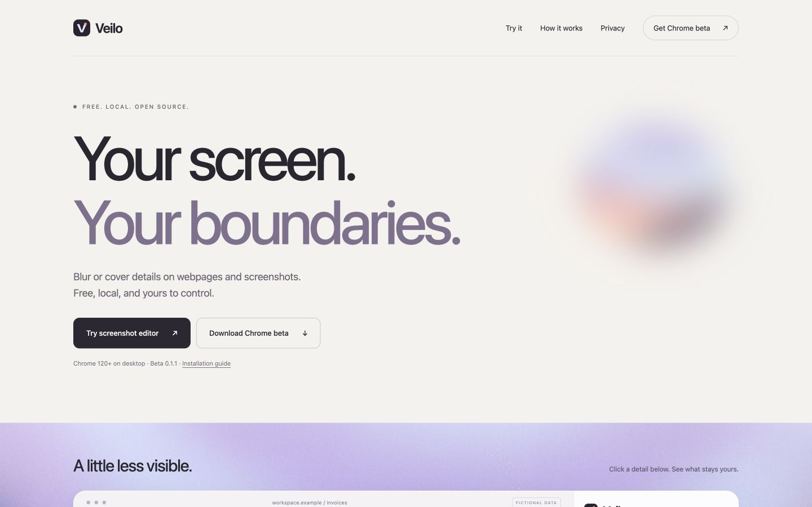

# Veilo

**Your screen. Your boundaries.** A free, local screenshot editor and Chrome extension for sharing a little less.

[Use Veilo](https://mariiateslia.github.io/veilo/) · [Screenshot editor](https://mariiateslia.github.io/veilo/editor.html) · [Chrome beta installation](https://mariiateslia.github.io/veilo/install.html)



## Two ways to use it

- **On the web:** open a PNG, JPG, or WebP, draw rectangular Blur or Cover masks, undo or reset, and save a flattened PNG. Cover is selected by default. The editor also has keyboard-accessible rectangle coordinates.
- **In desktop Chrome:** select webpage elements, switch Blur/Cover, adjust blur strength, pause, undo, or show all. Capture the visible tab and continue in the same screenshot editor.

No backend, account, subscription, analytics, remote fonts, or runtime dependencies. Images are processed in the tab. The website is hosted on GitHub Pages; normal hosting requests and logs are separate from image processing. See [Privacy](https://mariiateslia.github.io/veilo/privacy.html).

## Install the Chrome beta

1. Download the versioned ZIP from the website and extract it.
2. Keep the resulting **Veilo** folder in a permanent location.
3. Open `chrome://extensions` in desktop Chrome 120+, enable Developer mode, and click **Load unpacked**.
4. Select the **whole Veilo folder**, with `manifest.json` directly inside. Do not select the JSON file or the assets folder.
5. Pin Veilo and open an ordinary webpage to try it.

Chrome Web Store publication is a separate release. Chrome internal pages, the Web Store, and the built-in PDF viewer restrict extensions. Live page masks reset on navigation or reload, and dynamic pages may replace selected elements. The extension does not hide desktop apps or the browser toolbar.

**Blur is visual, not secure redaction.** For private information in exported images, use Cover and review the result. Live page effects only change appearance; they do not remove the website's underlying data.

## Develop

The extension and website use HTML, CSS, and JavaScript. Node packages are development-only. Node 22+ and Python 3 are required for tests/builds.

```sh
npm ci
npm test
npm run build
npm run check
python3 -m http.server 8770 --directory dist
```

Open `http://localhost:8770/`. To test the GitHub Pages subpath, serve the directory containing a `veilo` folder with the contents of `dist` and visit `/veilo/`.

| Folder | Purpose |
| --- | --- |
| `extension/` | Installable Manifest V3 extension, shared mask effects, and shared image editor |
| `site/` | Landing page, scoped fictional demo, web editor, installation guide, privacy |
| `scripts/` | Static build, ZIP packaging, release validation |
| `tests/` | DOM behavior and real PNG pixel regression checks |
| `demo/` | Local extension testing harness and fictional fixture; never included on the public site or in the installer |
| `dist/` | Generated static site and versioned installer; ignored by Git |

The build reads the version and minimum Chrome version from `extension/manifest.json`. Public assets are copied from the extension. Chrome capture transport stays in `editor-capture.js`, which is not shipped to the website. The site demo uses a scoped adapter over the same mask effects, without a Chrome API shim.

Pull requests run tests, build and validate the installer without publishing. Pushes to `main` run the same checks, then publish `dist/` through GitHub Actions to GitHub Pages. Enable Pages with **GitHub Actions** as the publishing source. No secrets or paid services are needed.

## License and assets

Code and the original Veilo mark: [MIT](LICENSE). The generated atmosphere background and screenshots have separate notices in [ASSETS.md](ASSETS.md). [Validation record](VALIDATION.md).
